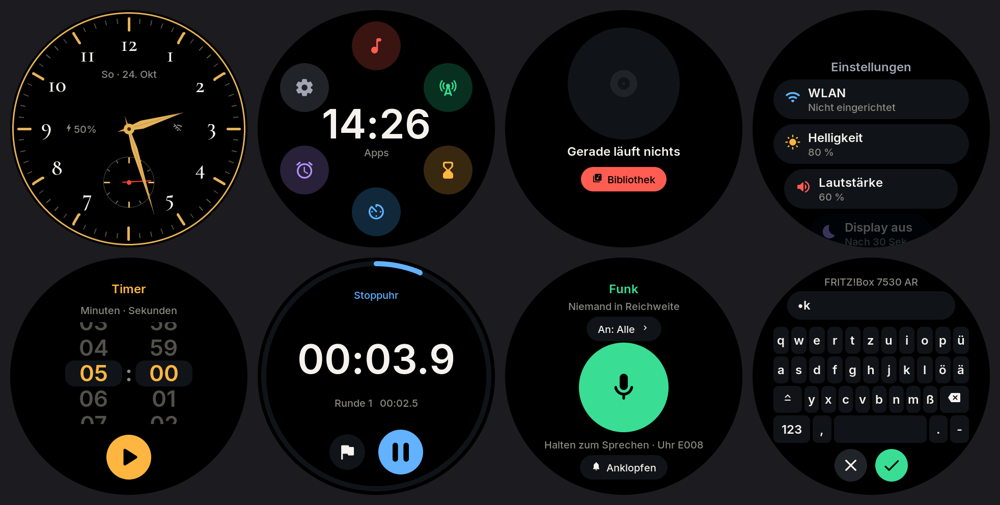

# Taschenfunk

Firmware für das **Waveshare ESP32-S3-Touch-AMOLED-1.75C** (rundes 466 × 466 AMOLED, Touch, Lautsprecher,
zwei Mikrofone, Bewegungssensor, Akku) und das fast gleiche **ESP32-S3-Touch-AMOLED-2.16** (quadratisch,
480 × 480; die runde Oberfläche sitzt dort mittig, die Ecken bleiben schwarz). Sie macht daraus eine Uhr mit Spotify, Podcasts, Walkie-Talkie, Timer,
Stoppuhr, Wecker, Wetter, Balance-Spiel und Kindermodus. Alles läuft auf dem Gerät selbst, ohne Rechner.



*Bildschirmfotos vom echten Gerät (`tools/remote.py`): Zifferblatt, Apps, Kindermodus-Zifferblatt (Frühstück,
Gute-Nacht-Geschichte), Balance (Wiese, Weltraum), Tastatur, QR-Code zur Weboberfläche.*

```
firmware/   PlatformIO-Projekt (Arduino-Core 3.3 / ESP-IDF 5.5, LVGL 9.2)
  lib/cspot Spotify-Connect-Client (cspot + bell, GPL-3.0, mit tools/vendor_cspot.sh eingebunden)
tools/      Fernsteuerung/Bildschirmfotos über USB, Schrift- und Zertifikat-Generatoren
```

## Was es kann

| App | Funktion |
|---|---|
| **Uhr** (Startseite) | Fünf Zifferblätter, **lange drücken** zum Wechseln: **Taschenuhr** sowie vier Designs aus [FaceLab](https://github.com/tobwil/garminwatchface): **Daylight**, **Sternenhimmel**, **Kiesel Text** und **Glitch**. Akku auf jedem Zifferblatt. |
| **Musik** | **Radio**: Sender aus dem freien Verzeichnis radio-browser.info (nur MP3), Beliebt, Kinderradio, Nachrichten, Genres, Suche; der laufende Songtitel kommt aus dem Stream, Weiter/Zurück wechselt den Sender, **Sender lange drücken = merken**. **ARD Audiothek** (ARD Sounds): Rubriken wie „Für Kinder“, Hörspiel, Wissen, Suche; Folgen mit gemerkter Position; **„Fußball live“** mit den Sportschau-Übertragungen (Konferenz und Einzelspiele, laufende und kommende), **alle ARD-Radiosender live**. **Podcasts** über die iTunes-Suche. **Favoriten** für Sender, Sendungen, Podcasts und Listen. **Spotify** ist eingebaut, Spotify gibt inoffiziellen Geräten bei vielen neueren Konten aber keinen Ton mehr (siehe unten). **Lautstärke:** Finger am Rand entlang ziehen oder Cover antippen; sie gleitet weich. |
| **Sprechen** | Mikrofon-Knopf halten und z. B. „Bibi und Tina Folge 1“ sagen. Gemini macht daraus die Suche. |
| **Funk** | Walkie-Talkie: großen Knopf halten und sprechen. In der Nähe per **ESP-NOW** (ohne Router), im selben WLAN zusätzlich per UDP-Multicast. |
| **Timer · Stoppuhr · Wecker** | Restzeit als Ring am Rand, Runden, Schlummern; der Wecker weckt auch aus dem Tiefschlaf. |
| **Wetter** | Open-Meteo, Standort per IP. |
| **Balance** | Uhr neigen, Kugel rollen lassen. **Ins Ziel**: eine Kugel ins goldene Loch, rote Löcher sind Fallen, mit jeder Stufe mehr. **Alle Kugeln**: drei Kugeln in drei Löcher, auf Zeit. Jede Stufe hat ein eigenes Thema (Wiese, Strand, Eis, Weltraum, Holz, Lava, Unterwasser, Zuckerwatte). Rekorde werden gespeichert. |
| **Einstellungen** | WLAN · Helligkeit · Lautstärke · Display aus · Funk · Spotify (Konten) · **Weboberfläche** (QR-Code) · Über das Gerät. |
| **Weboberfläche** | `http://taschenfunk-xxxx.local` bzw. die IP, fürs Handy gebaut: Name, WLAN, Spotify-Konten, Schlüssel, Favoriten und der Kindermodus. |

### Kindermodus

Ein- und ausschalten lässt er sich **nur über die Weboberfläche** (Reiter „Kinder“), auf Wunsch mit Eltern-PIN.
Ist er an:

- **Zifferblatt:** eine Pixel-Geschichte durch den Tag. Aufstehen, Frühstück, Kita oder Schule (am Wochenende
  Spielen), Mittagessen, Mittagsruhe, Draußen spielen, Abendessen, Baden und Zähne putzen,
  Gute-Nacht-Geschichte, Schlafen. Der Ring zeigt den ganzen Tag vom Aufstehen (oben) bis zur Bettzeit; was
  vorbei ist, ist dunkler. Aufstehen und Bettzeit stellt man ein (Standard 6:30 und 20:30), der Rest richtet
  sich danach.
- **Musik:** nur, was die Eltern freigegeben haben: Radiosender, Audiothek-Sendungen, Podcasts, Spotify-Listen.
  Freigeben geht über die Suche in der Weboberfläche, per Spotify-Link oder direkt aus den Favoriten. Auf der Uhr gibt es keine
  Suche, keine Sprache, keine Favoriten.
- **Apps:** Musik ist immer da; Funk, Timer, Stoppuhr, Balance, Wecker und Wetter einzeln erlaubt. Einstellungen
  und Zifferblatt-Wahl sind gesperrt.
- **Lautstärke** hat eine Obergrenze (Standard 60 %), auch wenn die Spotify-App lauter stellt.

**Wutmodus** (ebenfalls nur über die Weboberfläche, schaltet den Kindermodus mit ein). Auf der Uhr gibt es dann
nur noch das **Wut-Glas**; Wischen und Tasten tun nichts, Musik und Funk sind aus:

1. Rote Wut-Funken sitzen in der Uhr. Nur wer **richtig fest schüttelt**, schleudert sie über den Rand hinaus,
   höchstens ein paar pro Sekunde. So braucht es eine Weile echte Kraft, bis alles draußen ist. Der rote Ring
   zeigt, wie viel Wut noch drin ist.
2. „Alles raus!“: Es wird blau, ruhiger Glitzer sinkt nach unten, ein Kreis atmet vor (4 s ein, 6 s aus,
   vier Atemzüge).
3. „Gut gemacht!“ Kommt die Wut zurück, einfach wieder schütteln.

Schütteln weckt das Display; im Wutmodus geht die Uhr nicht in den Tiefschlaf. Die Weboberfläche zeigt, wie
oft heute die Wut rausgeschüttelt wurde.

## Bedienung

Aufgebaut wie bei Pixel Watch und Apple Watch: das Zifferblatt ist die Mitte, alles andere liegt eine
Wischbewegung entfernt.

| Wo | Geste / Taste | Wirkung |
|---|---|---|
| Zifferblatt | ↑ hochwischen | App-Liste |
| Zifferblatt | ↓ runterwischen | Kontrollzentrum: Lautstärke, Helligkeit, Funk-Empfang, Taschenlampe, Display aus, Einstellungen |
| Zifferblatt | ← nach links wischen | Kacheln: Musik · Wetter · Timer · Funk |
| Zifferblatt | lange drücken | Zifferblatt wählen |
| Zifferblatt | am Rand entlang ziehen | Lautstärke (solange Musik läuft) |
| überall | → nach rechts wischen | zurück |
| überall | **BOOT** kurz (wie die Krone) | auf dem Zifferblatt: Apps · sonst: zurück zum Zifferblatt |
| überall | **BOOT** halten | Funk an alle (Push-to-Talk) |
| überall | **PWR** kurz / lang | Display an/aus · Ausschalten/Neustart |

## Einrichten

1. **Firmware aufspielen**
   ```bash
   cp firmware/include/secrets.example.h firmware/include/secrets.h   # optional vorbelegen
   cd firmware && pio run -t upload                 # 1.75C
   cd firmware && pio run -e amoled-216 -t upload   # 2.16
   ```
   Die Unterschiede der Boards (Reset-Pins, Audio-Takt, Display-Ausrichtung, Touch-Achsen) stehen in
   `firmware/include/pins.h` und `config.h`.
   Erkennt der Rechner das Board nicht: **BOOT** halten, kurz **PWR** drücken, BOOT loslassen, erneut hochladen.
2. **WLAN** am Gerät: Apps → Einstellungen → WLAN.
3. **Weboberfläche** öffnen: Einstellungen → Weboberfläche zeigt einen QR-Code. Dort lassen sich alle weiteren
   Schlüssel eintragen. Die Uhr gibt Schlüssel nie zurück, sie lassen sich nur setzen.
4. **Spotify:** Auf [developer.spotify.com](https://developer.spotify.com/dashboard) eine App anlegen und
   Client-ID und Secret in die Weboberfläche eintragen. Damit funktioniert die Suche. Dann in der Spotify-App
   (Premium) die Uhr als Lautsprecher wählen (Handy im selben WLAN; auf dem iPhone braucht Spotify die
   Erlaubnis „Lokales Netzwerk“); sie merkt sich das Konto. Bis zu drei Konten sind möglich, jedes
   koppelt sich auf diese Weise; gewechselt wird in den Einstellungen oder in der Weboberfläche.
5. **Spracheingabe (optional):** einen Gemini-API-Schlüssel von [aistudio.google.com](https://aistudio.google.com) eintragen.

`secrets.h` steht in `.gitignore`. Was darin steht, ist nur die Vorbelegung. Was in der Weboberfläche
eingetragen wird, speichert die Uhr im NVS.

### Spotify: Ton bei neueren Konten gesperrt

Seit Ende 2025 verweigert Spotify inoffiziellen Connect-Geräten (librespot, cspot) bei vielen neueren Konten den
Audio-Schlüssel ([librespot#1649](https://github.com/librespot-org/librespot/issues/1649)). Koppeln, Anmelden und
Suchen funktionieren, abgespielt wird dann aber nichts; die Uhr hält an und zeigt „Spotify verweigert den Ton“.
Ältere Konten können noch funktionieren. Den Kopierschutz zu umgehen ist keine Option.

## Funk mit mehreren Geräten

Alle Geräte mit dieser Firmware finden sich automatisch. Für ESP-NOW müssen sie auf demselben WLAN-Kanal sein.
Geräte im selben WLAN sind das ohnehin, Geräte ohne WLAN bleiben auf Kanal 1 (`RADIO_CHANNEL`).

## Testen über USB

```bash
~/.platformio/penv/bin/python tools/remote.py /dev/cu.usbmodem* tap 233 233 wait 1 shot bild.png
```

Befehle im seriellen Monitor:

- **Eingaben:** `tap X Y`, `hold X Y`, `swipe l|r|u|d`, `boot`, `pwr`, `shot`
- **Seiten:** `page apps|music|timer|stopwatch|alarm|radio|settings|game|web`, `home`, `browse search:Coldplay`
- **Musik:** `toggle`, `next`, `vol 60`, `browse rl:tag:kids`, `browse ard:soccer`, `voice start` / `voice stop`
- **Kindermodus und Spiel:** `kids on|off`, `kidtime 7:10` (Zifferblatt zu einer Uhrzeit zeigen, `-1` = echte Zeit), `level 3` (Balance-Stufe), `imu` (Neigung), `angry on|off`, `shake 10` (10 s Schütteln vortäuschen)
- **Sonstiges:** `wifi SSID PASSWORT`, `face 0…4`, `timer 10`, `kb`, `status`

## Technik

- **Display:** CO5300 über QSPI (Arduino_GFX 1.6.9), LVGL 9.2 mit Bildpuffern und LVGL-Speicher im PSRAM.
- **Audio:** ES8311 + ES7210 im Vollduplex bei 44,1 kHz. Ein Mischer-Task mischt Musik, Funk und Klänge, mit
  Software-Lautstärke (Rampe, Begrenzer).
- **Spotify:** [cspot](https://github.com/feelfreelinux/cspot) (Fork von philippe44) für Connect und Wiedergabe
  (Ogg Vorbis über Tremor), dazu die Web-API für die Suche.
- **Podcasts, Audiothek, Radio:** ein MP3-Spieler (libhelix, Resampling); Range-Anfragen zum Springen, live mit ICY-Titeln und automatischem Neuverbinden. RSS-Parser im Datenstrom, Audiothek über GraphQL (api.ardaudiothek.de), Sender über radio-browser.info.
- **TLS:** mbedTLS mit dem CA-Bundle aus ESP-IDF (`tools/make_crt_bundle.sh`), Speicher dafür im PSRAM.
- **Cover:** JPEG-Decoder des Chips, rund maskiert; andere Formate über den Bild-Proxy wsrv.nl.
- **Bewegungssensor:** QMI8658, läuft nur im Spiel.
- **Module:**
  - `hw`, `audio`, `net`, `radio`, `clockwork`, `weather`, `imu`
  - `music` mit `spotify`, `podcast` (MP3-Spieler, auch live), `webradio`, `ard` und `favs`
  - `kids`, `voice`, `keys`, `webui`
  - `faces/` (FaceLab-Designs)
  - `ui/` (Seiten, Kindermodus-Zifferblatt `ui_kidface.cpp`, Wut-Glas `ui_angry.cpp`, Spiel `ui_game.cpp` + `game_theme.cpp`)

## Lizenz

`firmware/lib/cspot` steht unter GPL-3.0. Wer die Firmware mit cspot weitergibt, gibt sie damit auch unter
GPL-3.0 weiter.
