# Taschenfunk

Eine Uhr für die ganze Familie auf dem **Waveshare ESP32-S3-Touch-AMOLED-1.75C** (rund, 466 × 466) und dem
**ESP32-S3-Touch-AMOLED-2.16** (quadratisch, 480 × 480: volle Fläche, Listen über die ganze Breite, in den Ecken
des Zifferblatts Akku, Wetter, Datum und was gerade läuft): Radio,
ARD Audiothek mit Fußball live, Podcasts, eine KI-Assistentin mit Stimme, Walkie-Talkie, Radiowecker – und ein
Kindermodus mit Pixel-Tagesablauf, Freigaben und einem Wut-Glas zum Rausschütteln. Alles läuft auf der Uhr
selbst, eingerichtet wird vom Handy aus.

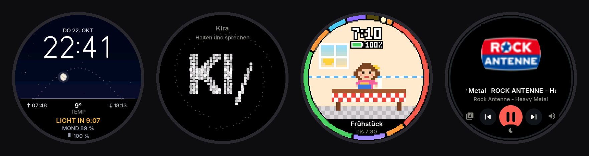

*Alle Bilder sind echte Bildschirmfotos – von der Uhr (`tools/remote.py`) und von der Weboberfläche im Handy-Browser.*

```
firmware/   PlatformIO-Projekt (Arduino-Core 3.3 / ESP-IDF 5.5, LVGL 9.2)
tools/      Fernsteuerung/Bildschirmfotos über USB, Schrift- und Zertifikat-Generatoren
docs/       Bilder und Videos
```

**Videos:** [Erwachsenenmodus](docs/videos/taschenfunk-erwachsene.mp4) · [Kindermodus](docs/videos/taschenfunk-kinder.mp4)

## Zifferblätter

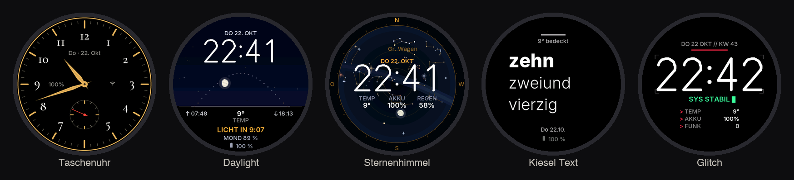

Taschenuhr mit kleiner Sekunde und vier Designs aus [FaceLab](https://github.com/tobwil/garminwatchface):
**Daylight** (echter Sonnenbogen, Mondphase, Wetter), **Sternenhimmel** (der Himmel über dem Standort),
**Kiesel Text** und **Glitch**. Auf dem Zifferblatt lange drücken zum Wechseln; der Akku ist überall zu sehen.

## Bedienung

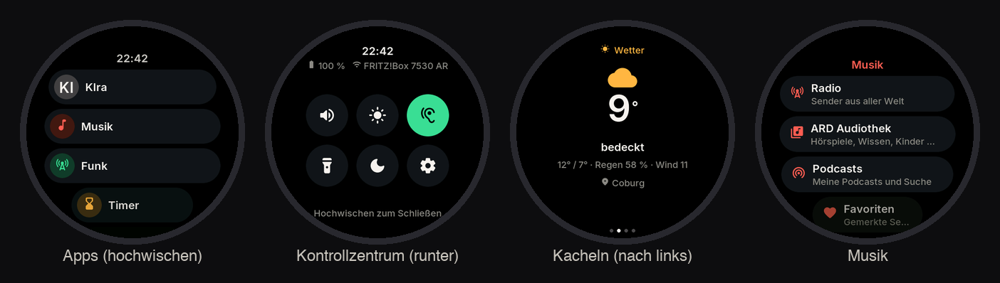

Wie bei Pixel Watch und Apple Watch ist das Zifferblatt die Mitte:

| Wo | Geste / Taste | Wirkung |
|---|---|---|
| Zifferblatt | ↑ hochwischen | Apps |
| Zifferblatt | ↓ runterwischen | Kontrollzentrum: Lautstärke, Helligkeit, Funk-Empfang, Taschenlampe, Display aus, Einstellungen |
| Zifferblatt | ← nach links wischen | Kacheln: Musik · Wetter · Timer · Funk |
| Zifferblatt | lange drücken | Zifferblatt wählen |
| überall | am Rand entlang ziehen | Lautstärke (solange Musik läuft) |
| überall | → nach rechts wischen | zurück |
| überall | **BOOT** kurz (wie die Krone) | Zifferblatt: Apps · sonst: zurück zum Zifferblatt |
| überall | **BOOT** halten | Funk an alle (Push-to-Talk); in KIra: sprechen |
| überall | **PWR** kurz / lang | Display an/aus · Ausschalten/Neustart |
| dunkles Display | **Doppeltipp** | Display an (ein einzelner Tipp, Wischen oder Stoff in der Tasche wecken nicht) |
| Tiefschlaf | **BOOT** kurz | aufwecken (Berührung weckt hier nicht) |

## Musik, Radio, ARD Audiothek

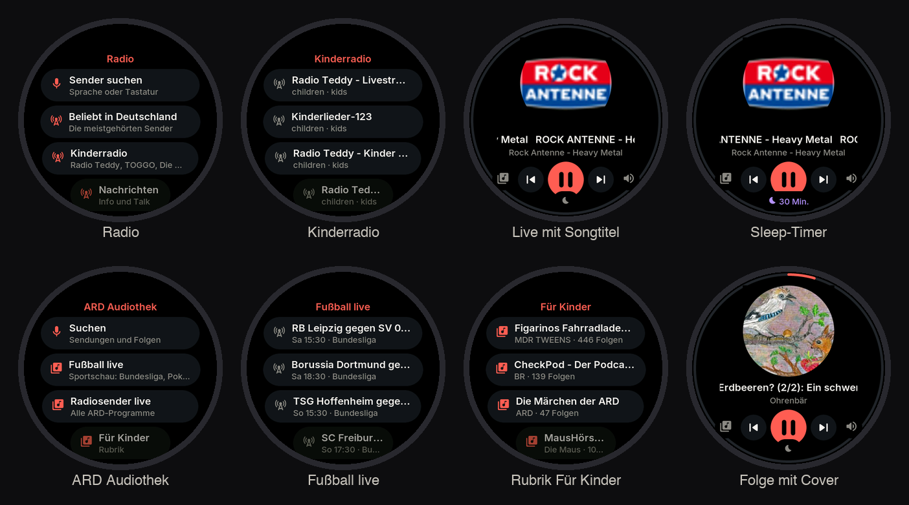

- **Radio:** Sender aus dem freien Verzeichnis radio-browser.info (MP3): Beliebt in Deutschland, Kinderradio,
  Nachrichten, Genres, Suche per Sprache oder Tastatur. Der laufende Songtitel kommt aus dem Stream,
  Weiter/Zurück wechselt den Sender.
- **ARD Audiothek / ARD Sounds:** Rubriken (Für Kinder, Hörspiel, Hörbuch, Wissen, Comedy …), Suche, Folgen mit
  gemerkter Position, **alle ARD-Radiosender live** und **„Fußball live“** – die Sportschau-Übertragungen
  (Bundesliga-Konferenz und Einzelspiele, 2. Liga, Pokal, Europapokal), laufende und kommende.
- **Podcasts** über die iTunes-Suche.
- **Weiter hören:** Angefangene Folgen zeigen in den Listen „bei 12:34“; nach dem Stoppen steht die zuletzt gehörte
  Folge oben in der Musik (und in der Weboberfläche) zum Weiterhören – bis sie zu Ende gehört ist.
- **Favoriten:** auf der Wiedergabe-Seite das **Herz** antippen – gemerkt wird der Sender, die
  Audiothek-Sendung bzw. der Podcast, der gerade läuft. In Listen geht es auch: Sender lange drücken, bei
  Sendungen und Podcasts die oberste Zeile „Als Favorit merken“.
- **Sleep-Timer:** den Mond unten antippen (15 – 90 Min.), am Ende wird sanft ausgeblendet.
- **Lautstärke:** Finger am Rand entlang ziehen oder Cover antippen; sie gleitet weich.

## KIra – die KI-Assistentin

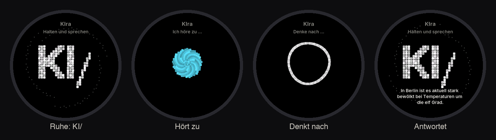

Gemini 3.8 Live mit Stimme, nur außerhalb des Kindermodus. App öffnen, **Bildschirm oder BOOT halten und
sprechen**, loslassen. Die Figur besteht aus kleinen Pixeln: in Ruhe das „KI/“ von KI/sruptiv, beim Zuhören
eine Kugel, die mit der Stimme atmet, beim Nachdenken ein kreisender Ring. KIra sucht im Netz (Google-Suche),
stellt Timer und Wecker und startet – falls eingerichtet – **n8n-Workflows und -Agenten** der eigenen Instanz.
Freigegeben wird in der Weboberfläche; vor Aktionen, die etwas verschicken oder ändern, fragt sie nach.
Anlegen, Ändern oder Löschen in n8n kann sie nicht.

## Wecker, Timer, Funk und mehr

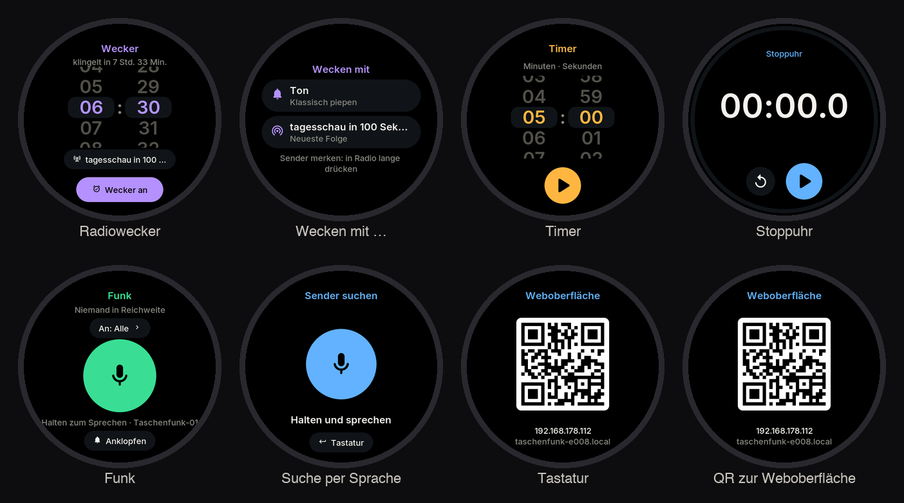

- **Radiowecker:** „Wecken mit“ Ton, *tagesschau in 100 Sekunden*, einem gemerkten Sender oder der neuesten
  Folge einer gemerkten Audiothek-Sendung; leise beginnend, über 45 s lauter. Ohne Ton nach 20 s klingelt er
  klassisch; der Wecker weckt auch aus dem Tiefschlaf.
- **Timer, Stoppuhr** mit Ring am Rand, Runden, Schlummern.
- **Funk:** Walkie-Talkie zwischen mehreren Uhren – in der Nähe per **ESP-NOW** (ohne Router), im WLAN per
  Multicast.
- **Wetter** von Open-Meteo, **Tastatur** mit großen Tasten, **QR-Code** zur Weboberfläche.

## Balance

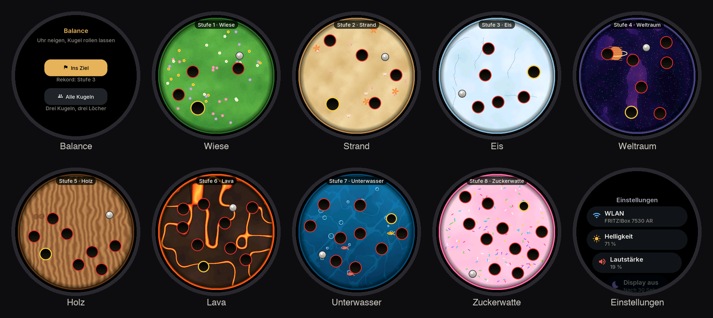

Uhr neigen, Kugel rollen lassen. **Ins Ziel**: eine Kugel ins goldene Loch. Die Stufen wechseln reihum –
**Mauern** (Slalom um Querwände), **Labyrinth** (Ringe mit je einer Öffnung, Ziel in der Mitte; später mit Sperren
und drittem Ring) und **Blockaden** (verstreute Hindernisse). Rote Löcher sind Fallen, aber nur wenige; jede Stufe
hat ein eigenes Thema. **Alle Kugeln**: drei Kugeln in drei Löcher, auf Zeit, mit zwei Mauern dazwischen. Oben stehen
Stufe bzw. laufende Zeit und der Rekord; die Rekorde zeigt auch die Weboberfläche (Reiter Kinder), nur dort
lassen sie sich zurücksetzen.

## Kindermodus

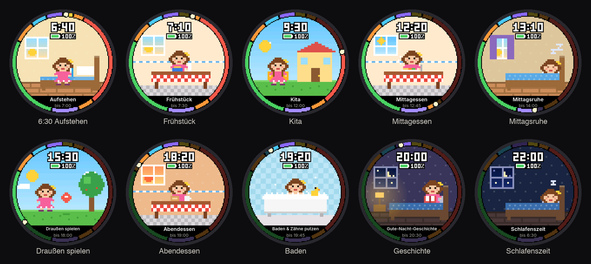

Ein- und ausgeschaltet wird **nur über die Weboberfläche** (Reiter „Kinder“, auf Wunsch mit Eltern-PIN).

- **Zifferblatt:** eine Pixel-Geschichte durch den Tag – ein Mädchen steht auf, frühstückt, geht in die Kita
  (am Wochenende: spielen), isst zu Mittag, ruht, spielt draußen, isst zu Abend, badet, hört eine
  Gute-Nacht-Geschichte und schläft. Der Ring zeigt den ganzen Tag vom Aufstehen bis zur Bettzeit; was vorbei
  ist, ist dunkler. Aufstehen und Bettzeit sind einstellbar (Standard 6:30 und 20:30), der Ablauf dazwischen
  auch – getrennt für Mo–Fr und Sa & So: Uhrzeit, Szene und auf Wunsch ein eigener Name („Schwimmkurs“).
- **Musik:** nur, was die Eltern freigegeben haben – Radiosender, ganze Audiothek-Sendungen und Podcasts oder
  einzelne Folgen.
- **Apps:** Musik ist immer da; Funk, Timer, Stoppuhr, Balance, Wecker, Wetter einzeln erlaubt. Keine
  Einstellungen, keine Zifferblatt-Wahl, keine KI.
- **Lautstärke** mit Obergrenze (Standard 60 %).
- **Fernbedienung:** in der Weboberfläche (Reiter „Musik“) Sender, Sendungen und Podcasts aussuchen, starten,
  anhalten, weiterschalten, Lautstärke und Sleep-Timer setzen – die Eltern dürfen alles, auch nachts.

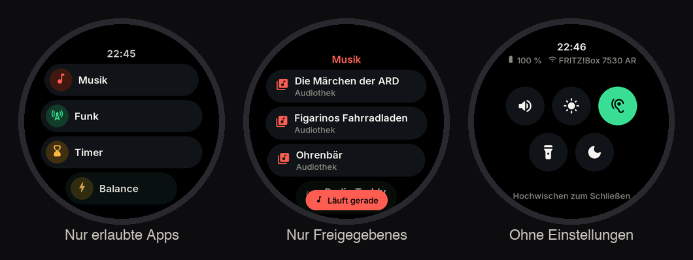

### Welten, Tier-Begleiter und Wochen-Abenteuer

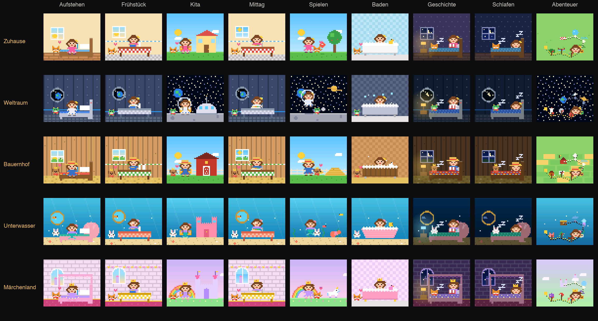

Unter Kinder → Zifferblatt: Die Pixel-Geschichte spielt **zuhause, im Weltraum, auf dem Bauernhof, unter Wasser
oder im Märchenland** – oder jede Woche woanders. Jede Welt hat eigene Zimmer, Fenster, Spielplätze und ein
eigenes Gebäude für Kita und Schule, und das Mädchen trägt Raumanzug, Latzhose mit Strohhut,
Meerjungfrauen-Schwanz oder Krone. Ein **Tier** (Katze, Hase, Hund oder Drache, mit eigenem Namen) ist überall
dabei und schläft nachts am Bettende; bei Sternen von heute freut es sich mit Herzchen, ab 20 Sternen trägt es
ein Halstuch, ab 60 eine Krone. Mit dem **Wochen-Abenteuer** wird die Spielzeit zur Karte: sieben Stationen,
jeden Tag ein Kapitel („Der rote Mars“, „Die Regenbogenbrücke“ …), die Figur wandert im Laufe der Zeit weiter.
Wer es ruhiger mag, schaltet den **Tagesablauf** aus: Dann spielt die Figur tagsüber, schläft nachts, und unten
stehen Wochentag und Datum.

Im Zifferblatt tauchen außerdem **Pferd Luna** und **Reh Fips** auf: Fips schaut morgens durchs Fenster, auf der
Wiese grast Luna und Fips hüpft herum, auf dem Bauernhof steht Luna auf der Koppel, unter Wasser schwimmt ein
Seepferdchen.

### Zähneputzen

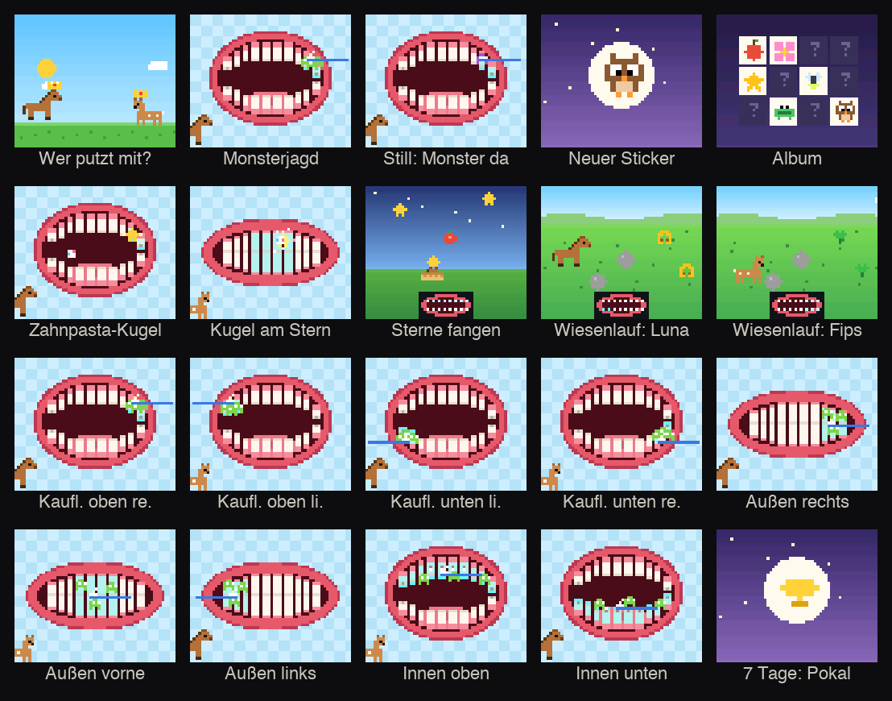

Eine App (für Kinder und Erwachsene, in der Weboberfläche abschaltbar): erst **Pferd Luna oder Reh Fips** wählen,
dann das Spiel. Geputzt wird nach der **KAI-Methode**, zwei Minuten: erst die **K**auflächen (vier Ecken, hin und
her), dann **A**ußen (Zähne aufeinander, kleine Kreise – rechts, vorne, links), dann **I**nnen (Mund weit auf, von
Rot nach Weiß). Der Mund im Bild zeigt wie im Spiegel, wo gerade dran ist, Zahnmonster verschwinden nach und nach,
und **Luna bzw. Fips sagen, wo es weitergeht** – mit echten Stimmen. Vier Spiele, jeden Tag ist ein anderes das
„Spiel des Tages“ (oben in Gold):

- **Monsterjagd** – die Uhr steht gegenüber auf dem Tisch und **hört zu**: Die Zahnmonster verschwinden nur,
  solange sie Putzen hört; wird es still, kommen sie zurück und grinsen. Das Bürstengeräusch erkennt sie auch nach
  zwei Minuten Dauerputzen noch (das Grundrauschen steigt nur in Stille mit); während eigener Ansagen hört sie weg.
- **Zahnpasta-Kugel** – Uhr in der freien Hand, die andere hält die Zahnbürste: die Kugel durch Kippen zum
  leuchtenden Stern rollen, der liegt immer in dem Bereich, der gerade geputzt wird.
- **Sterne fangen** – Luna bzw. Fips schaut aus dem Korb; nach links und rechts kippen und Sterne und Äpfel fangen.
- **Wiesenlauf** – nach vorn und hinten kippen: Steinen ausweichen, Hufeisen (Luna) bzw. Kleeblätter (Fips) sammeln.

- **Album:** Nach jedem Putzen ein neuer Sticker (24 Motive). Sieben Tage am Stück: ein Pokal, und Luna und Fips
  tragen eine Krone.
- **Zu zweit:** Putzen zwei Uhren gleichzeitig, melden sie sich über Funk („‹Name› putzt mit: Außen vorne“) – und beide
  bekommen Team-Herzen fürs Album.

Zum Schluss: „Ausspucken, nicht ausspülen“, auf Wunsch „Jetzt putzt Mama oder Papa nach“ (Weboberfläche), und
„Zähne putzen“ in der laufenden Routine wird abgehakt. Die Weboberfläche zeigt Serie, Rekorde und Album.

Die Ansagen erzeugt `tools/brush_voice.py` einmalig mit Gemini-TTS (MP3, 16 kHz) als `firmware/brushvoice.bin`
(≈ 240 KB), die in die Firmware eingebettet wird. Dort liegen auch sieben Hörgeschichten je Figur, in denen die
Putz-Hinweise in der Erzählung stecken – für später, nicht auf der Uhr (`--story`).
Die Szenen zeichnet `firmware/src/kidart.cpp` ohne LVGL – `sh tools/kidart_preview.sh` rendert sie am Rechner
als Übersicht.

### Schlafenszeit

Ab der Bettzeit bis zum Aufstehen ist die Uhr gesperrt: keine Apps, kein Funk, keine Kacheln, das Display
gedimmt. Nur die Musik bleibt noch eine Einschlafzeit lang (Kinder → Schlafenszeit → „Abends hören“: gar nicht
bis 2 Stunden, Standard 30 Minuten) und wird dann sanft ausgeblendet. Der Wecker funktioniert weiter.

### Routinen mit Sternen

*(abschaltbar: Kinder → Routinen → „Aufgaben auf der Uhr“)*

Morgens (ab dem Aufstehen – am Wochenende ab dem ersten Eintrag im Wochenend-Plan, wenn die Kinder länger schlafen – bis zum Mittagessen laut Tagesablauf; ist alles abgehakt, nach 2 Stunden) und abends (2 Stunden vor der Bettzeit) zeigt die App **Aufgaben** eine
kurze Liste zum Abhaken – Anziehen, Zähne putzen, Schlafanzug an … Jeder Haken gibt einen **Stern**, eine ganz
geschaffte Routine zwei Extrasterne und eine kleine Feier. Läuft eine Routine, öffnet ein Tipp aufs Zifferblatt
direkt die Liste. Die Aufgaben stehen in der Weboberfläche (Reiter „Kinder“, eine pro Zeile, bis zu acht), dort
auch die Sterne von heute, der Woche und insgesamt.

### Wutmodus

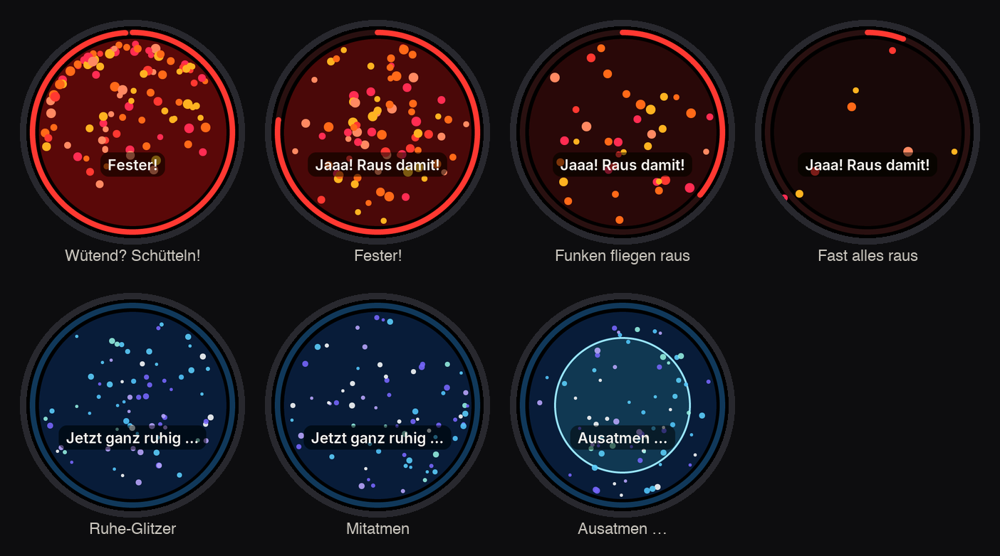

Für Momente, in denen die Gefühle zu groß werden. Ist er an (Weboberfläche), gibt es auf der Uhr nur noch das
**Wut-Glas**: Rote Funken sitzen darin, und nur wer **richtig fest schüttelt**, schleudert sie über den Rand –
ein paar pro Sekunde, so braucht es eine Weile echte Kraft. Ist alles draußen, wird es blau, ruhiger Glitzer
sinkt, und ein Kreis atmet vor (4 s ein, 6 s aus). Wischen und Tasten tun nichts, Musik und Funk sind aus.
Die Weboberfläche zeigt, wie oft heute die Wut rausgeschüttelt wurde.

## Funk mit dem Handy und Uhr finden

- **Funk mit dem Handy:** In der Weboberfläche „Funk vom Handy“ antippen (`https://<Uhr>/funk`). Knopf halten
  und sprechen, die Uhr spielt die Stimme ab und zeigt „Handy spricht“. **Antworten:** auf der Uhr BOOT halten
  und sprechen, solange die Seite offen ist – die Stimme kommt aus dem Handy.
- **Uhr finden:** „Uhr klingeln lassen“ – 30 s Piepen mit „Hier bin ich!“, auch bei dunklem Display.

## Weboberfläche

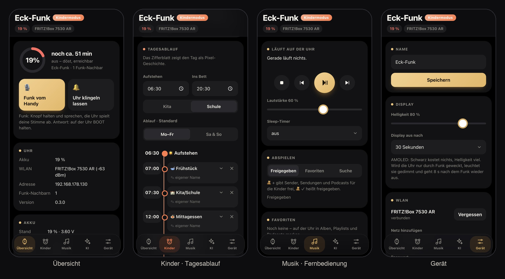

`https://<IP der Uhr>` (QR-Code unter Einstellungen → Weboberfläche; `http://` leitet um). Fürs Handy gebaut,
hell und dunkel (im Dunkeln echtes Schwarz wie auf der Uhr), mit Akku-Ring, schwebender Navigation und
Zeitleiste für den Tagesablauf. Reiter:

- **Übersicht:** Akku mit Restlaufzeit und Verlauf, Funk vom Handy, Uhr klingeln lassen, Sparmodus, Tiefschlaf, Nachtruhe
- **Kinder:** Kindermodus, Wutmodus, Tagesablauf, Routinen und Sterne, Balance-Rekorde, Schlafenszeit, Lautstärke, Apps, Freigaben, PIN
- **Musik:** Fernbedienung (abspielen, steuern, Lautstärke, Sleep-Timer), Suche mit 🧸 + zum Freigeben, Favoriten
- **KI:** Name, Google-Suche, Modelle und Stimme, n8n mit Freigaben
- **Gerät:** Name, Display (Helligkeit, Display-Zeit), WLAN, Gemini-Schlüssel, Firmware, Sicherung

Direkt verlinkbar (`#kinder`, `#musik`, `#ki`, `#geraet`). Schlüssel und Tokens werden nur gesetzt, nie ausgelesen.

**Nur HTTPS:** Die Uhr stellt sich beim ersten Start ein eigenes Zertifikat aus, deshalb warnt der Browser
einmal („trotzdem öffnen“) – danach ist die Verbindung verschlüsselt, auch PIN und Schlüssel. HTTPS ist
außerdem nötig, damit der Browser das Mikrofon für den Funk freigibt.

**Sicherung:** Gerät → Sicherung lädt alle Einstellungen als JSON herunter (WLAN, Kindermodus, Freigaben,
Routinen, Favoriten, KI, n8n-Freigaben) und spielt sie wieder ein – etwa auf die zweite Uhr. Passwörter, PIN und
Schlüssel kommen nur mit dem Haken „Mit Geheimnissen“ in die Datei.

## Einrichten

1. **Firmware aufspielen**
   ```bash
   cp firmware/include/secrets.example.h firmware/include/secrets.h   # optional vorbelegen
   cd firmware && pio run -t upload                 # 1.75C
   cd firmware && pio run -e amoled-216 -t upload   # 2.16
   ```
   Die Unterschiede der Boards (Reset-Pins, Audio-Takt, Display-Ausrichtung, Touch-Achsen) stehen in
   `firmware/include/pins.h` und `config.h`.
   Erkennt der Rechner das Board nicht: **BOOT** halten, kurz **PWR** drücken, BOOT loslassen, erneut hochladen.
2. **WLAN** am Gerät: Apps → Einstellungen → WLAN.
3. **Weboberfläche** öffnen: Einstellungen → Weboberfläche zeigt einen QR-Code. Dort lassen sich alle weiteren
   Schlüssel eintragen. Die Uhr gibt Schlüssel nie zurück, sie lassen sich nur setzen.
4. **Gemini (KIra und Spracheingabe):** einen Gemini-API-Schlüssel von [aistudio.google.com](https://aistudio.google.com) eintragen.
5. **n8n (optional):** im Reiter „KI“ die MCP-Adresse der Instanz und einen MCP-Token eintragen, dann Workflows und Agenten laden und freigeben.

`secrets.h` steht in `.gitignore`. Was darin steht, ist nur die Vorbelegung. Was in der Weboberfläche
eingetragen wird, speichert die Uhr im NVS.

## Akku und Sparmodus

Die Weboberfläche zeigt Stand, Spannung, Verbrauch (%/h), eine geschätzte Restlaufzeit und den Verlauf der
letzten sechs Stunden (alle 2 Minuten ein Messpunkt). Die Restlaufzeit steht auch auf der Uhr im
Kontrollzentrum („noch ca. 5 h 20 min“). Geschätzt wird aus mindestens 20 Minuten ohne Laden; der Verlauf
übersteht Neustarts, Updates und Tiefschlaf. Bei 10 % gibt es eine Warnung, bei 3 % schaltet die Uhr
geordnet aus.

**Immer:** Wird nichts gestreamt, schläft das WLAN-Funkmodul zwischen den Beacons des Routers (Funk mit
anderen Uhren läuft im WLAN per Multicast weiter). Bei dunklem Display **döst** die Uhr: Der Prozessor geht
automatisch in den Leichtschlaf (ESP-IDF Power Management), die Oberfläche zeichnet nichts, der Audio-Teil
hält 3 s nach dem letzten Ton an. Sie bleibt dabei im WLAN erreichbar – für Funk und die Weboberfläche – und
wacht per Doppeltipp sofort auf. Ohne WLAN (nur ESP-NOW) bleibt das Funkmodul wach.

**Nachtruhe** (Weboberfläche → Akku): Im Kindermodus schläft die Uhr von Bettzeit + Einschlafzeit bis zum
Aufstehen im Tiefschlaf (Standard an), sonst auf Wunsch zwischen eigenen Zeiten. Sie schläft in Etappen von
höchstens 2 Stunden und stellt dazwischen dunkel per WLAN ihre Uhr nach. Der Wecker klingelt pünktlich, BOOT
weckt jederzeit; nachts ist sie aber nicht erreichbar. Beim Dösen meldet sie sich nur alle 30 s bei den anderen
Uhren (sonst alle 3 s).

**Tiefschlaf** (Weboberfläche → Akku): „nie“ (Standard, immer erreichbar) oder nach 10/30/60 Minuten mit
dunklem Display. Im Tiefschlaf ist auch das WLAN aus: kein Funk, keine Weboberfläche, wecken nur mit BOOT.
Musik, Timer und Funk halten die Uhr wach, eine pausierte Wiedergabe nicht. Die Weboberfläche zeigt, was sie
gerade wach hält; `/api/pm` zeigt Schlafanteile und Sperren.

Gebaut wird dafür das Arduino-Framework mit eigener ESP-IDF-Konfiguration (`custom_sdkconfig` in
`platformio.ini`); der erste Build dauert einige Minuten länger.

**Display:** Helligkeit und Display-Zeit stellt man auch in der Weboberfläche ein (Gerät → Display). Wird die
Uhr nur durch eingehenden Funk geweckt, leuchtet sie gedimmt (30 %) und geht 8 s nach dem Funk wieder aus –
bis jemand sie anfasst.

**Sparmodus** (automatisch ab 20 %, oder immer): Display höchstens 40 % hell und nach 10 s aus, Zifferblätter
nur noch einmal pro Sekunde, kein Funk im Hintergrund; ist ein Tiefschlaf eingestellt, kommt er schon nach
3 Minuten.

## Updates per WLAN

Weboberfläche → Gerät → Firmware: `firmware.bin` auswählen und „Aktualisieren“. Oder vom Rechner:

```bash
sh tools/ota.sh 192.168.178.112 amoled-175c   # baut und schickt die Firmware (über HTTPS)
```

Die Uhr prüft, ob die Datei für ihr Board gebaut ist (rund/eckig), und lehnt sonst ab.

## WLAN

Beim Start verbindet sich die Uhr sofort mit dem zuletzt benutzten Netz, sonst mit dem stärksten bekannten
(bis zu sechs werden gemerkt). Reißt die Verbindung ab, versucht sie es erst beim selben Netz und sucht dann in
wachsenden Abständen nach bekannten Netzen: 10 s, 20 s, 40 s … bis 1 Minute bei eingeschaltetem Display, bis
5 Minuten bei dunklem. Wird das Display eingeschaltet, sucht sie gleich wieder. Läuft gerade Funk, wartet die
Suche, denn sie unterbricht ESP-NOW kurz.

## Funk mit mehreren Geräten

Alle Geräte mit dieser Firmware finden sich automatisch. Für ESP-NOW müssen sie auf demselben WLAN-Kanal sein.
Geräte im selben WLAN sind das ohnehin, Geräte ohne WLAN bleiben auf Kanal 1 (`RADIO_CHANNEL`).

## Testen über USB

```bash
~/.platformio/penv/bin/python tools/remote.py /dev/cu.usbmodem* tap 233 233 wait 1 shot bild.png
```

Befehle im seriellen Monitor:

- **Eingaben:** `tap X Y`, `hold X Y`, `swipe l|r|u|d`, `boot`, `pwr`, `shot`
- **Seiten:** `page apps|music|timer|stopwatch|alarm|radio|settings|game|brush|web`, `home`, `browse search:Coldplay`
- **Musik:** `toggle`, `next`, `vol 60`, `browse rl:tag:kids`, `browse ard:soccer`, `voice start` / `voice stop`, `page assist`, `talk on` / `talk off` (Assistentin), `sleep 1` (Sleep-Timer), `alarm 7:30`, `alarmsrc ard:set:10815223 Name` (`-` = Ton)
- **Kindermodus und Spiel:** `kids on|off`, `kidtime 7:10` (Zifferblatt zu einer Uhrzeit zeigen, `-1` = echte Zeit), `level 3` (Balance-Stufe), `imu` (Neigung), `tilt 0.3 -0.2` / `tilt off` (Neigung vortäuschen), `angry on|off`, `shake 10` (10 s Schütteln vortäuschen)
- **Zähneputzen:** `page brush`, `brush save` / `brush load` (Album, Serie und Rekorde sichern und zurückholen; dazwischen wird die Routine nicht abgehakt), `ear on|off` (was das Mikrofon bei der Monsterjagd hört, je Prüfung eine Zeile)
- **Sonstiges:** `wifi SSID PASSWORT`, `face 0…4`, `timer 10`, `kb`, `status` (mit Laufzeit und freiem Speicher), `dump` (alle Texte auf dem Bildschirm und der obersten Ebene mit Lage), `poweroff`

### Testsammlung

```bash
sh tests/run_host.sh                                              # am Rechner: Hören, Zeichnen, Sprachdatei, Weboberfläche, beide Builds
~/.platformio/penv/bin/python tests/device/test_device.py          # auf der Uhr (USB + WLAN), lautlos
~/.platformio/penv/bin/python tests/device/test_device.py --sound  # dazu die Monsterjagd mit Rauschen aus dem Rechner (hörbar!)
```

- **Am Rechner** (`tests/host`): Die Geräuscherkennung (`hearing.cpp`, derselbe Code wie auf der Uhr) bekommt
  Bürstenrauschen, Stille, Summen von 80 bis 520 Hz, beides gemischt und zwei Minuten Dauerputzen. Alle
  Zeichnungen laufen mit vielen Werten (auch außerhalb des Bildes) gegen Schutzbereiche; Sticker müssen sich
  unterscheiden, Ziele der Zahnpasta-Kugel erreichbar sein. Die Sprachdatei muss jede Ansage für beide Figuren
  enthalten, jedes Stück muss sich dekodieren lassen und in seinen Abschnitt passen; das Skript der Weboberfläche muss
  gültig sein und jede angesprochene ID im HTML finden. Dazu: keine großen Felder auf dem Stapel (8 KB) und ein
  Budget für den statischen internen RAM – beides hat schon Abstürze gefunden.
- **Auf der Uhr** (`tests/device`, Regression der ganzen Uhr): Status und Weboberfläche (Felder, Umleitung auf https,
  404, keine Geheimnisse in Antworten und Sicherung, Einstellungen hin und zurück, Update-Schutz gegen Datenmüll und
  die Firmware der anderen Uhr), alle Seiten, Kinder-Zifferblatt zu zehn Tageszeiten, im Erwachsenen-Modus alle
  Zifferblätter, Wischen hin und zurück (Kacheln, Apps, Kontrollzentrum), Timer mit Klingeln und Stopp, Balance mit
  vorgetäuschter Neigung (Rekorde bleiben), ein Radiosender mit gleichzeitigen Web-Anfragen, Funk-Seite; dazu das
  ganze Zahnputz-Menü, die drei Kipp-Spiele (der Test steuert Korb, Kugel und Figur anhand der Bildschirmfotos), mit
  `--sound` die Monsterjagd, ein voller Zwei-Minuten-Durchlauf (KAI-Reihenfolge, Dauer, Sticker, Serie) und zum
  Schluss: kein Neustart, genug interner Speicher, keine Musik.
- **Leise und ohne Spuren:** Die Uhr steht während der Tests auf Lautstärke 0. Album, Serie und Rekorde werden vorher
  gesichert und danach zurückgeholt, Kindermodus, Zifferblatt und Lautstärke wieder eingestellt, die Routine wird
  nicht abgehakt.

## Technik

- **Display:** CO5300 über QSPI (Arduino_GFX 1.6.9), LVGL 9.2 mit Bildpuffern und LVGL-Speicher im PSRAM.
- **Audio:** ES8311 + ES7210 im Vollduplex bei 44,1 kHz. Ein Mischer-Task mischt Musik, Funk und Klänge, mit
  Software-Lautstärke (Rampe, Begrenzer).
- **Podcasts, Audiothek, Radio:** ein MP3-Spieler (libhelix, Resampling); Range-Anfragen zum Springen, live mit ICY-Titeln und automatischem Neuverbinden. RSS-Parser im Datenstrom, Audiothek über GraphQL (api.ardaudiothek.de), Sender über radio-browser.info.
- **TLS:** mbedTLS mit dem CA-Bundle aus ESP-IDF (`tools/make_crt_bundle.sh`), Speicher dafür im PSRAM.
- **Cover:** JPEG-Decoder des Chips, rund maskiert; andere Formate über den Bild-Proxy wsrv.nl.
- **Bewegungssensor:** QMI8658, läuft nur im Spiel und im Wutmodus.
- **Weboberfläche:** esp_https_server mit selbst ausgestelltem EC-Zertifikat (im NVS); der HTTPS-Task übergibt
  jede Anfrage an die Hauptschleife, weil Oberfläche und Wiedergabe nicht threadsicher sind. Firmware-Uploads
  schreibt er direkt in den Flash.
- **KI:** Gemini 3.8 Live über einen eigenen WebSocket-Client (TLS), Push-to-Talk, 16 kHz hinein, 24 kHz Stimme in den Sprachkanal; n8n über den MCP-Server der Instanz (JSON-RPC, Server-Sent Events).
- **Speicher:** große Puffer im PSRAM, Tasks für KI und Spracheingabe nur während einer Anfrage – so bleiben gut 100 KB internes RAM für TLS frei.
- **Module:**
  - `hw`, `audio`, `net`, `radio`, `clockwork`, `weather`, `imu`
  - `music` mit `podcast` (MP3-Spieler, auch live), `webradio`, `ard` und `favs`
  - `kids`, `routines`, `voice`, `keys`, `backup`
  - `webui` (Seite und API) auf dem HTTPS-Server aus `phone` (esp_https_server, auch Funk mit dem Handy)
  - `assist` (Gemini Live), `wsock` (WebSocket über TLS), `n8n` (MCP-Client mit Freigabeliste)
  - `faces/` (FaceLab-Designs)
  - `ui/` (Seiten, Kindermodus-Zifferblatt `ui_kidface.cpp`, Wut-Glas `ui_angry.cpp`, Spiel `ui_game.cpp` + `game_theme.cpp`)
